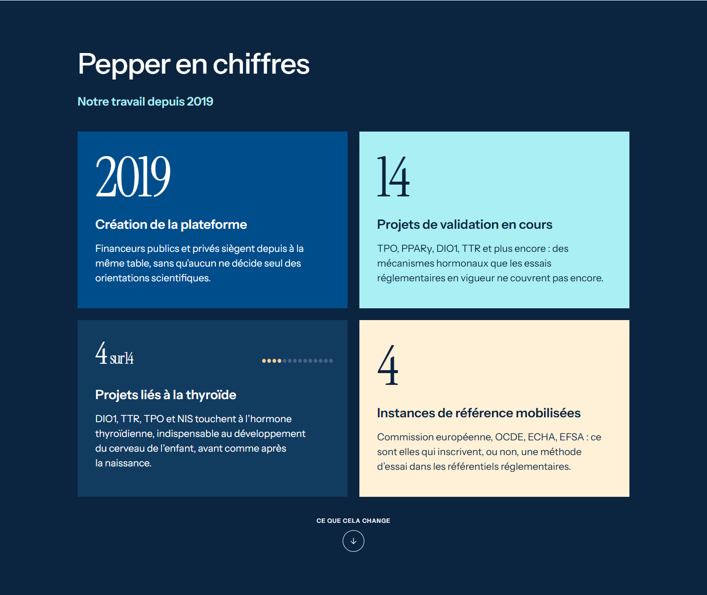
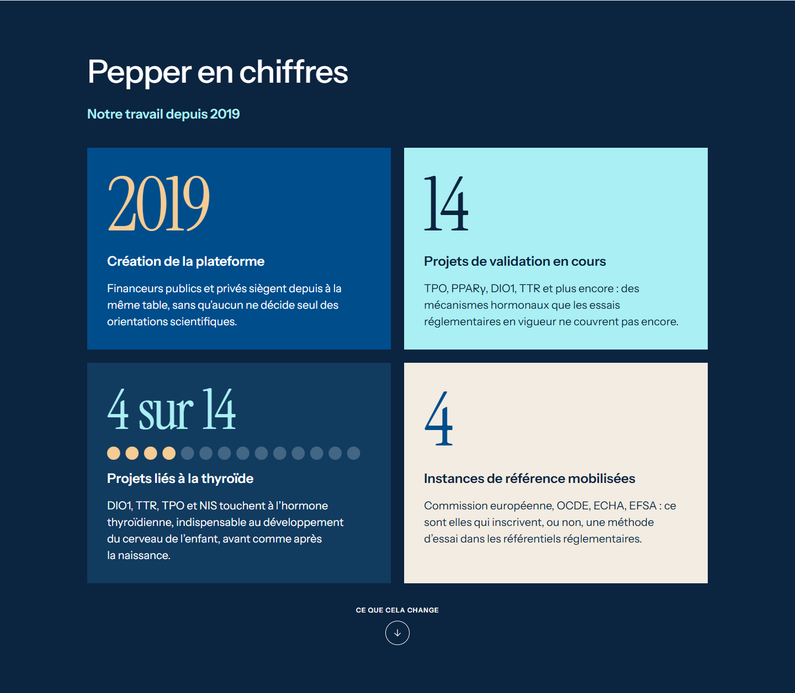
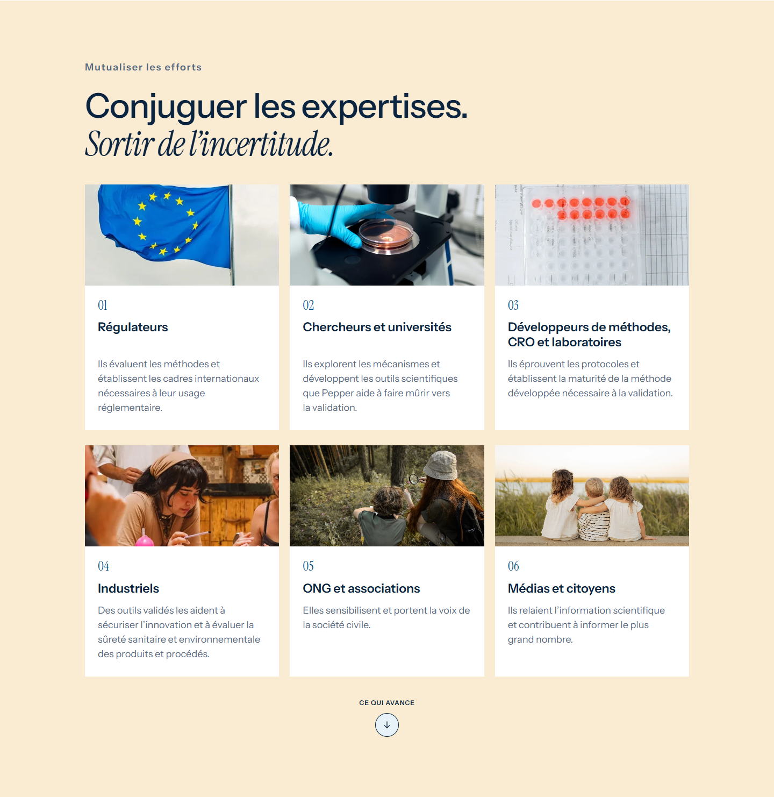

# Contre-audit · Maquette 3 · 5 novembre 2026

Version examinée : `2ba3eed`. Références Figma : accueil `17:38`, article
`84:173`, direction artistique `68:162`. Le premier contrôle établissait le
fonctionnement et l’absence de débordement ; il ne mesurait pas les axes des
textes. Les captures et valeurs de ce contre-audit complètent cette preuve.

## Constats confirmés avant correction

| Priorité | Entrée | Défaut observé | Correction attendue |
|---|---|---|---|
| P1 | Accueil · Chiffres | Dans la deuxième rangée, les titres et paragraphes démarrent avec 37 px d’écart à 1 440 px. « 4 sur 14 » est réduit et la proportion SVG est déplacée en haut à droite. | Partager les rangées de la grille, rétablir la métrique et le SVG sous sa valeur. |
| P1 | Accueil · Projets | Les sigles utilisent Instrument Serif ; le Figma emploie Instrument Sans Medium. Le retrait interne de 18 px remplace les 32 px du cadre. | Restaurer police, couleur et axe à 32 px. |
| P2 | Accueil · Expertises | Les descriptions dérivent selon le nombre de lignes des titres. | Partager les rangées des titres et descriptions par rangée de cartes, sans masquer le texte. |
| P2 | Article | La colonne de lecture commence vers x=602 au lieu de x=589 à 1 440 px. L’image occupe environ 466 px au lieu de 444 px. | Restaurer la grille photographique 444 / 73 / 732, avec adaptation fluide. |
| P2 | Accueil · Actualités | Les rôles du surtitre et du grand titre sont inversés. | Rétablir « Actualités et événements » en surtitre et « Ce qui avance » en titre. |
| P2 | Direction artistique | Les exemples et la palette ajoutent des écarts de taille et d’alignement à la planche. | Aligner les blocs et conserver des exemples photographiques aux proportions prévues. |

## Préconisation UX/UI

- Problème utilisateur : la dérive des colonnes et des hauteurs gêne la lecture
  comparative et la présentation de cette proposition au client.
- Point d’entrée : accueil, liens par tableaux, première actualité et bouton M.
- Hiérarchie : conserver les contenus et les parcours ; respecter les rôles de
  titre, surtitre, valeur, libellé, description et indication de proportion.
- États : vérifier FR et EN, polices chargées, menu fermé/ouvert, focus clavier,
  textes à 200 %, formulaires et refus du presse-papiers. Les états de données
  restent ceux de la démonstration fournie ; aucun chargement métier n’est ajouté.
- Feedback : la progression, le tableau actif et les messages des dialogues
  restent visibles et compréhensibles. La correction de mise en page se constate
  dans les axes des colonnes et les captures comparatives.
- Données : chiffres et textes du Figma, sans nouvelle affirmation scientifique.
- Responsive : grilles partagées sur ordinateur, regroupement en deux colonnes
  puis empilement ; aucune hauteur fixe susceptible de tronquer une traduction.
- Accessibilité : ordre de lecture HTML conservé, titres natifs, focus visible,
  texte redimensionnable et mouvement réduit. Le SVG reste une illustration
  décorative d’une proportion déjà formulée en texte.
- Cohérence : mêmes composants et interactions que la version publiée ; aucune
  modification des maquettes 1 et 2 ou de l’assistant Mon Chai.

## Critères d’acceptation UX/UI

1. Les titres et descriptions d’une même rangée de chiffres ou d’expertises
   commencent sur le même axe vertical, à 1 px près, en FR comme en EN.
2. Les sigles des projets utilisent Instrument Sans et le même retrait interne.
3. À 1 440 px, image et colonne de l’article retrouvent les axes du cadre Figma.
4. À 320, 390, 768, 1 024, 1 280, 1 440 et 1 920 px, aucun texte ne déborde
   de son bloc ; le zoom texte à 200 % conserve l’accès aux contenus.
5. Navigation, M, article, dialogues et copie des couleurs passent dans Chromium
   et WebKit ; des captures comparatives documentent les points corrigés.

## Résultats après correction

- Deuxième rangée de chiffres : écart de 37 px avant correction, **0 px**
  entre titres et entre débuts de descriptions après correction à 1 440 px.
- Six descriptions d’expertises alignées par rangée, à **0 px** d’écart.
- Retrait des projets : **32 px** sur ordinateur ; police Instrument Sans.
- Article : photographie à x=72, largeur **444 px**, colonne à **x=589**,
  largeur **732 px**, conformément au cadre de référence.
- **114 contrôles de mise en page** et **36 mesures d’alignement** pour cette
  variante : neuf largeurs, FR/EN, Chromium/WebKit et texte agrandi à 200 %.
- Aucun chevauchement, débordement de texte, lien d’ancre cassé, image absente,
  identifiant dupliqué, erreur HTTP ou JavaScript dans ces parcours.
- M, aller-retour de langue, article, lecture par tableaux, formulaire de
  contact, menu mobile, copie réussie/refusée et navigation sans JS vérifiés.

Ces vérifications ne constituent pas un audit WCAG complet. La disposition
mobile est une adaptation responsive des cadres desktop fournis.

| Chiffres avant | Chiffres après |
|---|---|
|  |  |

| Expertises avant | Expertises après |
|---|---|
|  |  |

Preuve détaillée : [mesures et parcours](contre-audit-verification.json).
Les preuves de la livraison précédente sont conservées et datées ; le présent
rapport précise les écarts qu’elles ne détectaient pas.
