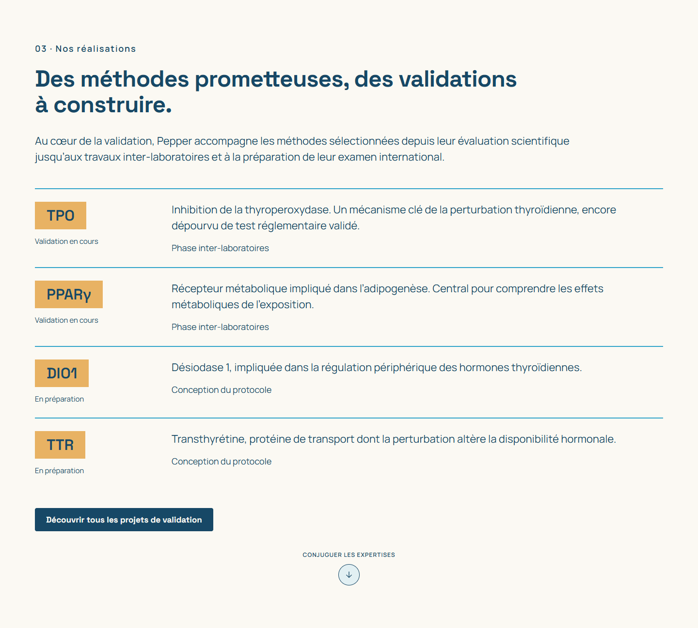
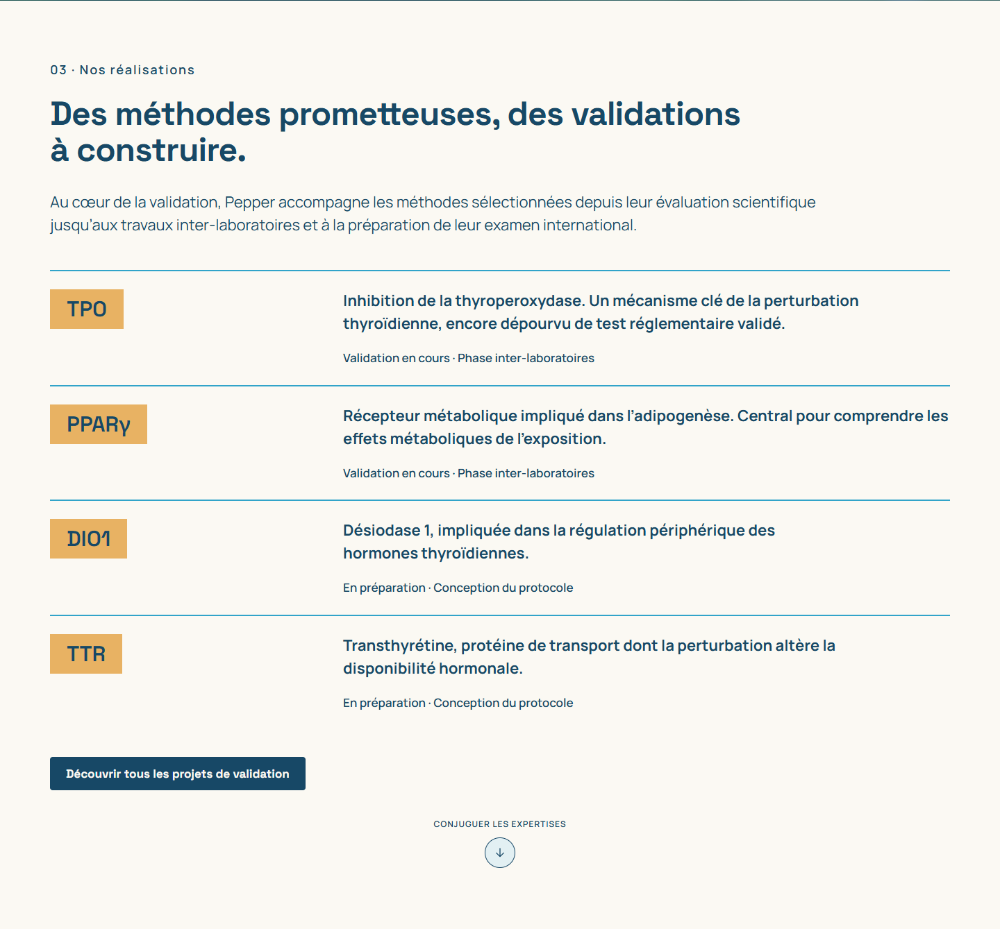
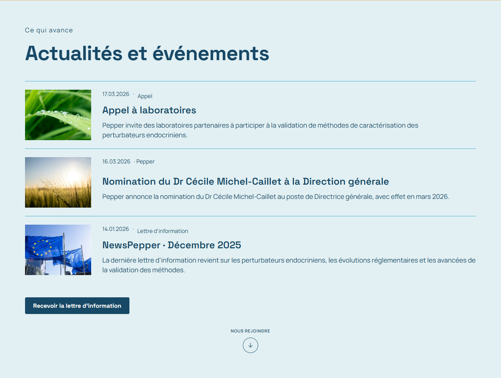
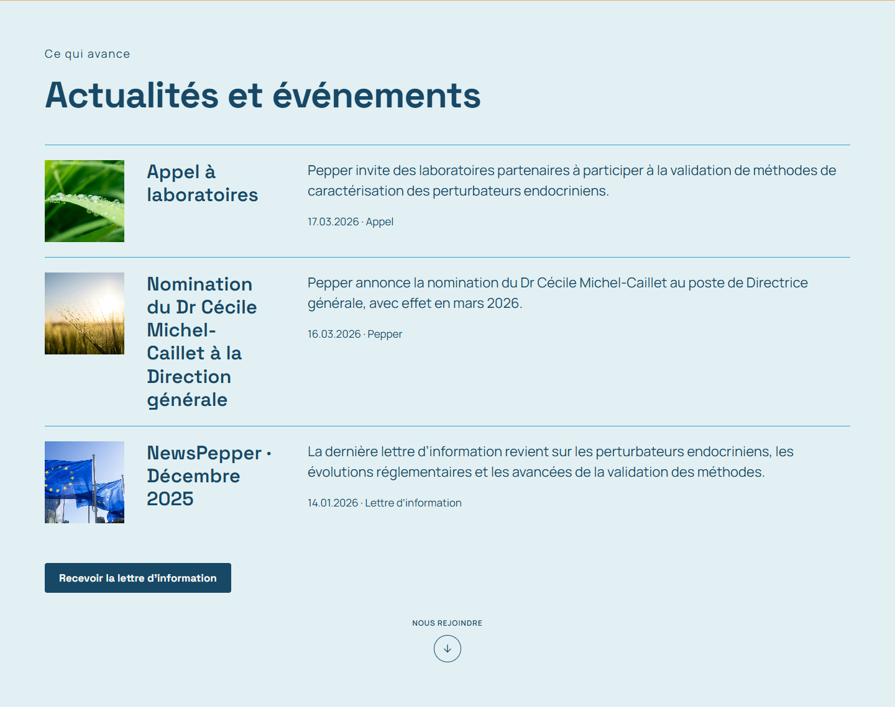
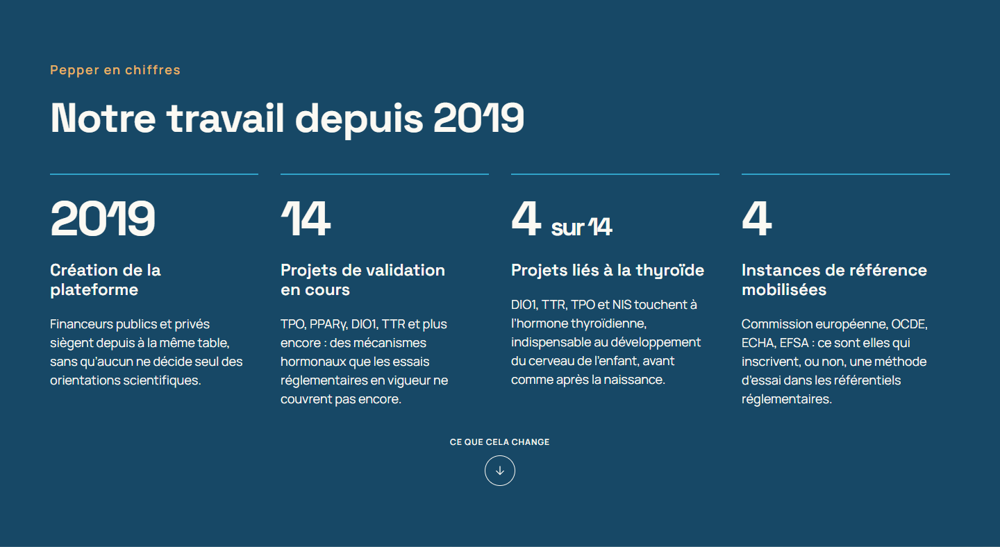
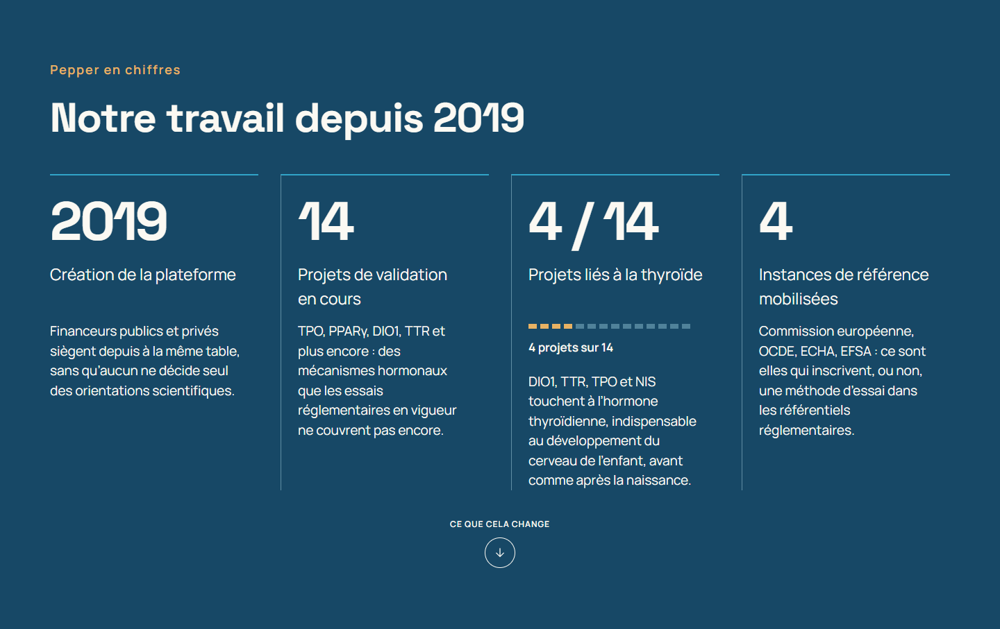
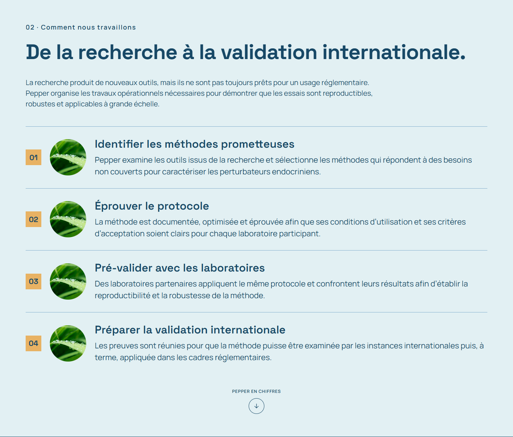
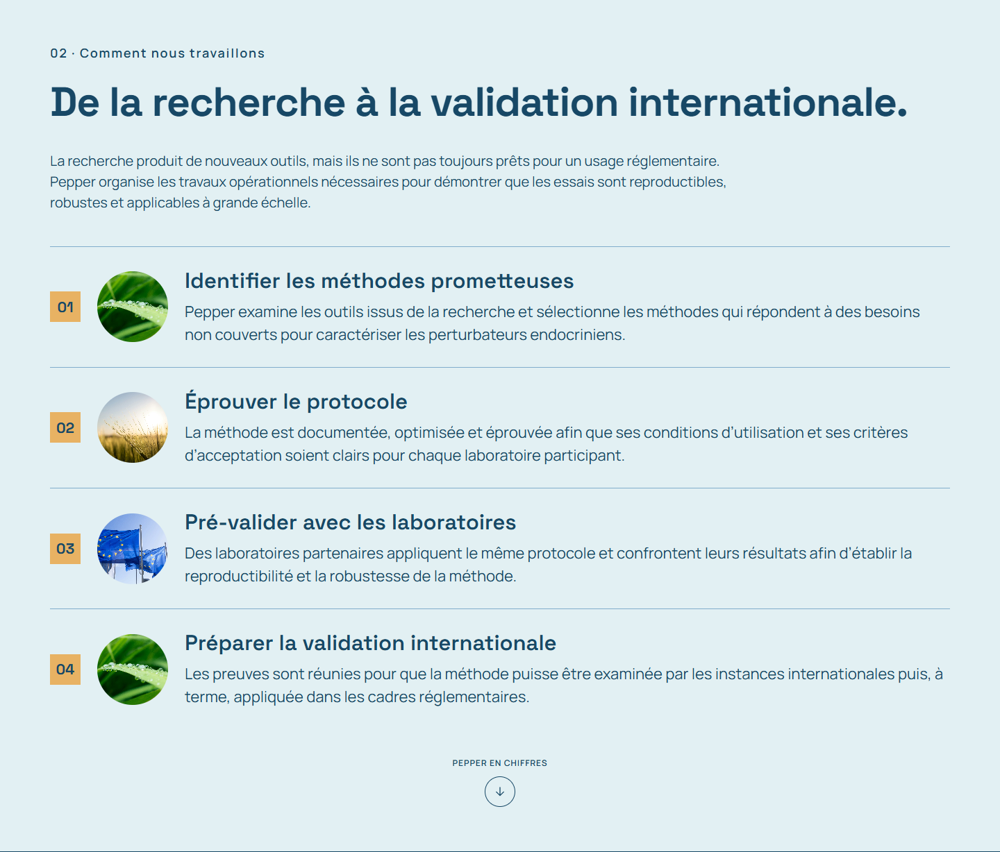

# Contre-audit · Maquette 4 · 5 novembre 2026

Version examinée : `2ba3eed`. Références Figma : accueil `71:128`, article
`84:98`, direction artistique `65:450`. Ce contrôle mesure les axes de lecture,
en complément des tests fonctionnels de la première livraison.

## Constats confirmés avant correction

| Priorité | Entrée | Défaut observé | Correction attendue |
|---|---|---|---|
| P1 | Mission, projets, expertises, adhésion | Les descriptions ne partagent pas l’axe x≈495 du Figma à 1 440 px : les projets commencent environ 141 px trop à gauche, la mission environ 123 px. | Utiliser la même grille éditoriale pour ces sections. |
| P1 | Chiffres | Le paragraphe de la troisième colonne commence 28 px plus haut que les autres ; les 14 repères de proportion et leur légende sont absents. | Partager la rangée des libellés et restaurer la proportion à l’emplacement prévu. |
| P1 | Actualités | Les titres sont regroupés avec les descriptions dans une même grande colonne. Le Figma distingue image, titre et description. | Restaurer les trois axes, aligner les textes à leur début et placer la date sous la description. |
| P2 | Article | La séparation du hero est à x=720 au lieu de 704. Les 24 px de largeur de texte supplémentaires changent les retours du titre. | Retrouver le partage 704 / 736 et la largeur de lecture de 584 px à 1 440 px. |
| P2 | Accueil · Adhésion | Le titre et l’introduction du premier bloc sont repris du deuxième ; le lien « Devenir membre » manque à côté de la vidéo. | Restaurer les deux étapes éditoriales et le lien interne prévu vers le parcours d’adhésion. |
| P2 | Expertises | Des numéros ajoutés décalent les cartouches ; le Figma n’en comporte pas dans cette section. | Rétablir les cartouches et leur axe commun avec les projets. |
| P2 | Direction artistique | L’exemple d’application et le troisième échantillon typographique sont remplacés par une présentation issue de la variante verte. | Rétablir Manrope SemiBold et les indications d’application de Cyan et miel. |
| P2 | Méthode et impact | Les étapes 2 et 3 montrent toutes deux la rosée ; le bandeau d’impact montre un champ. Ces emplacements ne correspondent pas au Figma. | Restaurer champ et drapeaux aux étapes 2 et 3, puis rosée sur l’impact. |
| P2 | Introduction | La colonne de titre est réduite à une moitié d’écran et son accent cyan est absent ; le fond de la photo utilise la mauvaise couleur. | Rétablir les proportions de colonnes, l’accent du titre et l’aplat miel de la référence. |
| P2 | Lisibilité | Le cyan de palette sur le fond clair du hero donne environ 2,68:1 ; il est aussi employé pour des petits retours de copie. | Utiliser un cyan de texte légèrement assombri pour le grand titre et l’encre marine pour les petits retours, en conservant la palette de fond. |

## Préconisation UX/UI

- Problème utilisateur : des axes variables empêchent de comparer rapidement
  les acteurs, méthodes et possibilités de participation.
- Point d’entrée : accueil et navigation par tableaux, article, M et lien vers
  le parcours d’adhésion placé dans le bloc de présentation.
- Hiérarchie : conserver le texte de la maquette, distinguer repère, titre,
  description, statut, date et action ; partager l’axe des descriptions.
- États : contrôler FR/EN, textes longs, polices chargées, menu illustré ouvert
  et fermé, zoom texte, focus et retours des dialogues. Les aperçus restent sans
  transmission ni stockage ; les erreurs de copie gardent leur récupération.
- Feedback : le lien d’adhésion conduit au parcours existant, les repères et la
  barre de lecture indiquent la position ; le menu se referme au choix d’un lien.
- Données : proportion explicite de 4 projets sur 14, dates et contenus fournis
  dans le Figma ; aucune fiche ni actualité supplémentaire n’est inventée.
- Responsive : trois colonnes pour les actualités sur grand écran, adaptation
  intermédiaire, puis image et titre suivis du texte sur mobile. Les autres
  listes partagent une grille qui devient une colonne sans troncature.
- Accessibilité : titres structurés, ordre HTML cohérent avec la lecture mobile,
  actions nommées et clavier, focus visible et mouvement réduit. La proportion
  reste lisible sans couleur grâce à sa légende textuelle.
- Cohérence : styles de la direction Cyan et miel et interactions déjà livrées.
  Le lien d’adhésion utilise l’ancre existante ; aucune nouvelle route métier.

## Critères d’acceptation UX/UI

1. À 1 440 px, les descriptions des listes commencent autour de x=495, avec
   moins de 2 px d’écart entre sections.
2. Les valeurs et libellés des quatre chiffres partagent leurs rangées. Les
   14 repères comptent exactement 4 accents miel et leur légende est traduite.
3. Les actualités présentent trois axes distincts sur ordinateur, sans titre
   masqué ; le regroupement mobile reste lisible dans l’ordre image/titre/texte.
4. Le hero d’article retrouve sa séparation à x=704 à 1 440 px ; les contenus
   restent lisibles de 320 à 1 920 px, en FR/EN et avec texte agrandi à 200 %.
5. Le lien « Devenir membre » atteint le parcours existant, M et l’article
   conservent la langue, menu et dialogues fonctionnent dans les deux moteurs.

## Résultats après correction

- À 1 440 px, les descriptions de mission, projets, acteurs, adhésion et
  actualités débutent à **494–495 px**, soit **1 px d’écart maximal**.
- Valeurs et libellés des quatre chiffres alignés à **0 px** d’écart. Les
  blocs de détail partagent leur rangée ; le troisième conserve ensuite la
  proportion et sa légende avant le paragraphe, comme le prévoit le Figma.
- Les **14 repères**, dont **4 miel**, sont présents. Le texte de proportion
  reste lisible indépendamment des couleurs et traduit en anglais.
- Article : séparation du hero à **x=704**, photographie de **736 px**,
  colonne de lecture à **x=402**, largeur **820 px**.
- Étapes photographiques : rosée, champ, drapeaux, rosée ; bandeau d’impact
  sur rosée. Le bloc de présentation et son lien d’adhésion sont rétablis.
- Accent de texte du hero : `#2B94B6`, environ **3,25:1** sur son fond clair
  pour ce grand texte ; les retours de copie utilisent l’encre marine. La
  palette présentée et les aplats conservent leurs codes Figma.
- **114 contrôles de mise en page** et **36 mesures d’alignement** pour cette
  variante : neuf largeurs, FR/EN, Chromium/WebKit et texte agrandi à 200 %.
  Les derniers ajustements du titre et des familles de caractères font aussi
  l’objet de vérifications ciblées consignées dans le même fichier de preuve.
- Aucun chevauchement, débordement de texte, lien d’ancre cassé, image absente,
  identifiant dupliqué, erreur HTTP ou JavaScript dans ces parcours.
- M, langue, article, lecture par tableaux, lien d’adhésion, formulaire,
  menu mobile, copie réussie/refusée et navigation sans JS vérifiés.

Les tests ne constituent pas un audit WCAG complet. Les cadres fournis sont
desktop ; la disposition mobile est une adaptation responsive explicite.

| Projets avant | Projets après |
|---|---|
|  |  |

| Actualités avant | Actualités après |
|---|---|
|  |  |

| Chiffres avant | Chiffres après |
|---|---|
|  |  |

| Étapes avant | Étapes après |
|---|---|
|  |  |

Preuve détaillée : [mesures et parcours](contre-audit-verification.json).
Les preuves antérieures restent conservées comme historique de la livraison.
